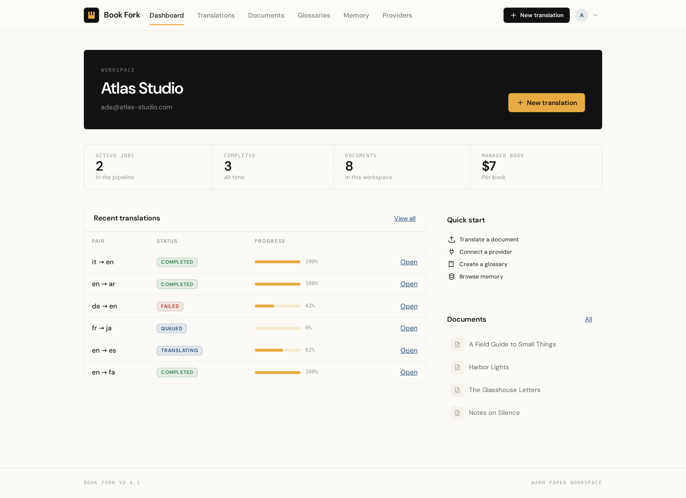
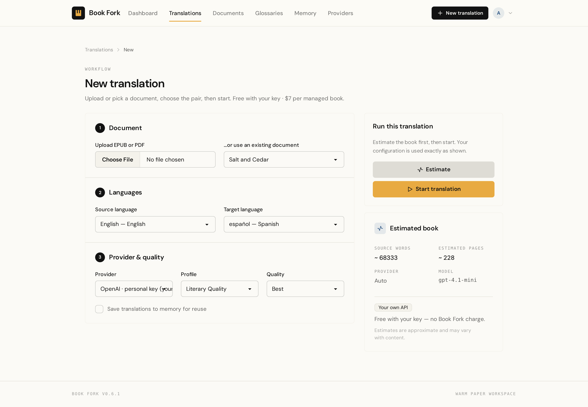
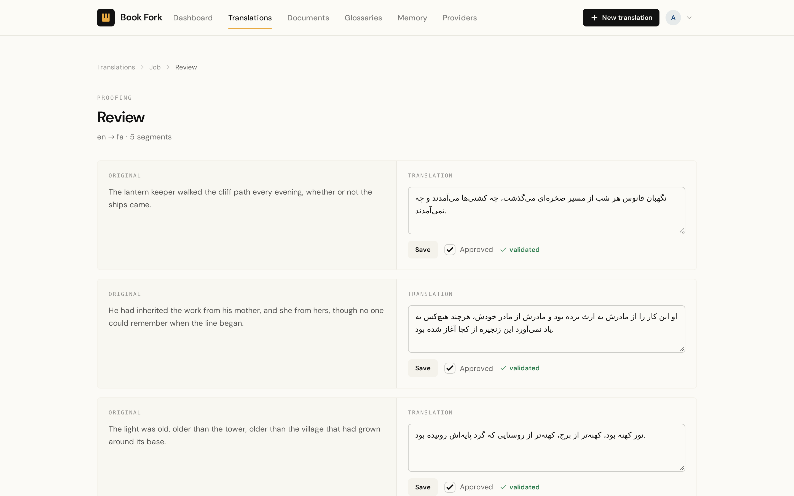
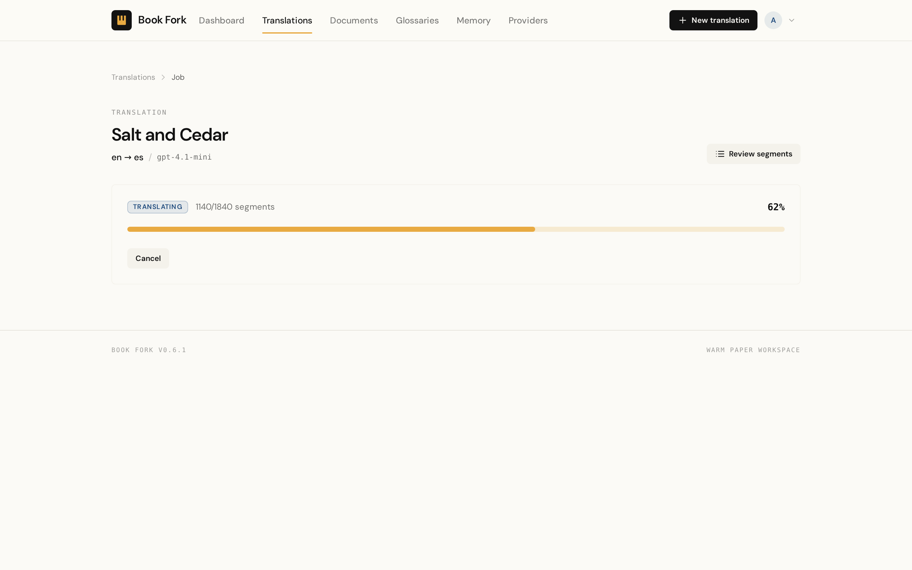
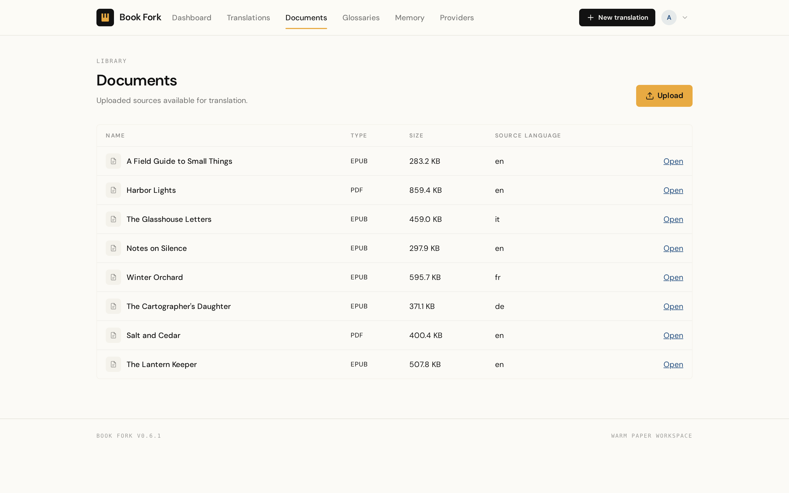
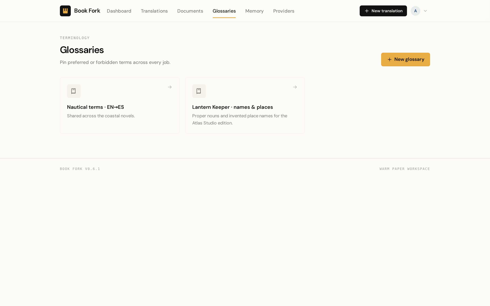
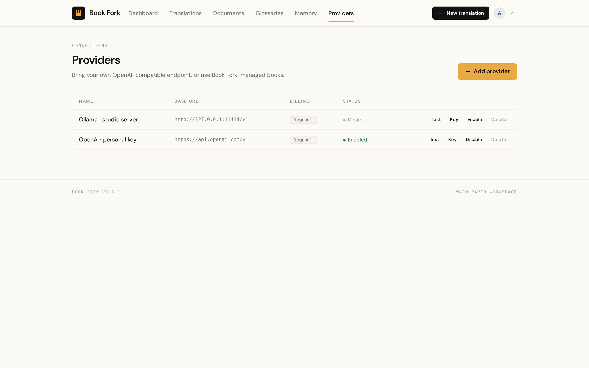
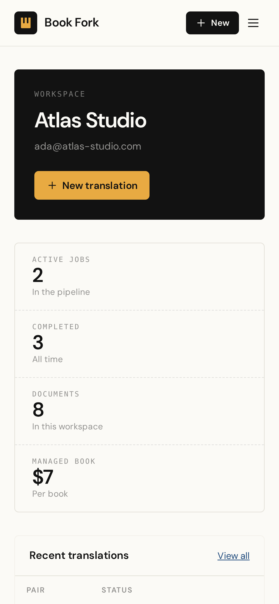

<p align="center">
  
</p>

<h1 align="center">Book Fork</h1>

<p align="center">
  <strong>Translate whole books. Keep every word.</strong><br>
  EPUB and PDF translation between any two languages, with glossaries, memory,<br>
  review, and resumable jobs — self-hosted, or on managed credits.
</p>

<p align="center">
  <a href="https://github.com/Rastin-Amani/Book-Fork/actions/workflows/ci.yml"></a>
  <a href="LICENSE"></a>
  <a href="https://github.com/Rastin-Amani/Book-Fork/releases"></a>
  <a href="https://github.com/Rastin-Amani/Book-Fork/pkgs/container/book-fork"></a>
  <a href="https://github.com/Rastin-Amani/Book-Fork/stargazers"></a>
  <a href="https://github.com/Rastin-Amani/Book-Fork/commits/main"></a>
</p>

<p align="center">
  <a href="https://www.python.org/"></a>
  <a href="https://fastapi.tiangolo.com/"></a>
  <a href="https://htmx.org/"></a>
  <a href="https://pocketbase.io/"></a>
  <a href="docs/deployment.md"></a>
  <a href="docs/architecture.md"></a>
  <a href="docs/architecture.md"></a>
  <a href="CONTRIBUTING.md"></a>
</p>

<p align="center">
  <a href="https://bookfork.space/en/">Website</a> ·
  <a href="https://bookfork.space/en/how-it-works">How it works</a> ·
  <a href="https://bookfork.space/en/features">Features</a> ·
  <a href="https://bookfork.space/en/self-hosting">Self-hosting</a> ·
  <a href="https://bookfork.space/en/pricing">Pricing</a> ·
  <a href="https://bookfork.space/en/open-source">Open source</a> ·
  <a href="docs/README.md">Docs</a>
</p>

<p align="center">
  <sub>v0.6.1 · pre-1.0 · MIT · 427 tests · CI runs ruff, mypy and pytest</sub>
</p>

<p align="center">
  
</p>

Most document translators stop at a wall of text in a chat window. A book is not
a prompt: it has chapters, running heads, footnotes, placeholders, names that
must stay consistent, and thousands of paragraphs that can fail halfway through.

**Book Fork treats a book as a job.** Upload an EPUB or PDF, choose a language
pair and a quality profile, and a durable worker translates it in resumable
segments. Every translated paragraph can be reviewed and edited before export.

Translation behaviour is configuration, not code: languages, providers, models,
prompts, quality profiles, limits, pricing, and retention all live in PocketBase
records. The engine stays provider-agnostic and the worker survives restarts
without Redis or Celery.

Two ways to run it:

- **Bring your own key** — connect any OpenAI-compatible endpoint (including
  vLLM, LiteLLM, and Ollama) and use Book Fork for free. Your provider bills you.
- **Managed book** — a flat **$7 per book** up to 1,000 pages, **+$7 for each
  extra 1,000-page block**, shown as an estimate before the job starts.

Self-host it with Docker under the MIT license, or use the
[managed app](https://app.bookfork.space/login) and skip the server work.

## Contents

- [Screenshots](#screenshots)
- [Why Book Fork](#why-book-fork)
- [Stack](#stack)
- [How it works](#how-it-works)
- [Quick start](#quick-start)
  - [Local development](#local-development)
  - [Docker](#docker)
- [Self-host or managed](#self-host-or-managed)
- [Configuration](#configuration)
- [Security and privacy](#security-and-privacy)
- [Known limitations](#known-limitations)
- [Project structure](#project-structure)
- [Development and tests](#development-and-tests)
- [Documentation](#documentation)
- [Contributing](#contributing)
- [License](#license)

## Screenshots

> Screenshots use a seeded demo workspace; the product is shown as it runs, not
> as a marketing mockup.

**Dashboard** — active jobs, completed books, recent translations and the
workspace library in one view.


**New translation** — pick a document, languages, provider and quality profile,
then see the page and word estimate before starting.



**Segment review** — read the source and translation side by side, edit a
paragraph, save it, and approve it for reuse in translation memory.



**Durable job progress** — segments completed, failures surfaced, cancellation
respected, and output downloadable when the book is done.



**Documents, glossaries and provider connections** — the workspace around the
translation itself.

<p align="center">
  
  
</p>

<p align="center">
  
</p>

**Mobile** — the same workspace, laid out for phones.

<p align="center">
  
</p>

## Why Book Fork

- **Books, not text boxes.** The document engine parses EPUB and PDF into a
  canonical book model, segments it by structure, protects placeholders and
  inline markup, and exports **EPUB and PDF** when the job finishes.
  [Document engine →](docs/documents.md)
- **Resumable by design.** A lease-based worker claims jobs from PocketBase,
  heartbeats, retries with backoff, resumes failed segments without redoing
  validated ones, and honours cancellation. No Redis, no Celery.
  [Worker →](docs/worker.md)
- **Consistent terminology.** Glossaries pin preferred and forbidden terms;
  approved translation-memory entries are reused per exact language pair with no
  provider call — and therefore no cost.
  [Glossary and memory →](https://bookfork.space/en/features/glossary-memory)
- **Human review before export.** Every segment can be edited and approved in
  the review workspace. Approval feeds translation memory.
  [Review →](https://bookfork.space/en/features/review)
- **Provider-agnostic.** One OpenAI-compatible adapter covers OpenAI, vLLM,
  LiteLLM, OpenRouter-style gateways and local Ollama. Add another protocol with
  one adapter; the engine stays untouched.
  [Providers →](docs/providers.md)
- **Configuration, not hardcoded behaviour.** Language pairs, direction, models,
  prompts, quality profiles, batch sizes, retries, limits, pricing and retention
  are data. The same build can run one language pair or sixty.
  [Data model →](docs/data-model.md)
- **Multi-language from the registry.** The seed ships **60 languages**, with
  CLDR-derived scripts and LTR/RTL direction. Add a language without touching
  Python. [Languages →](https://bookfork.space/en/features/languages)
- **Keys stay secret.** Provider credentials are encrypted at rest with Fernet,
  masked in the UI, never logged, and decrypted only to build the client.
  [Security →](docs/security-audit.md)
- **Boring operations.** Web and worker are separate processes; PocketBase is
  the only datastore; storage is local disk or S3-compatible. Health checks for
  the app, PocketBase, storage and worker are built in.
  [Operations →](docs/operations.md)

## Stack

| Layer | Technology |
|---|---|
| Web | Python 3.14, FastAPI, Jinja2, HTMX 2, Alpine.js 3 |
| UI | Tailwind CSS 4, daisyUI 5, self-hosted DM Sans, “Warm Paper Workspace” theme |
| Data | [PocketBase](https://pocketbase.io) 0.40 — schema in `pb_migrations/` |
| Worker | Standalone asyncio process (`python -m worker.main`) |
| Documents | PyMuPDF (PDF), lxml (EPUB), pysbd (segmentation), Babel/CLDR (languages) |
| Storage | Local filesystem or S3-compatible object storage |
| Providers | OpenAI-compatible chat completions + Ollama; encrypted credentials, SSRF guard |
| Packaging | `uv` (Python), npm (frontend), Docker / GHCR |

Architecture, layering and the version table: [`docs/architecture.md`](docs/architecture.md).

## How it works

```
Upload EPUB/PDF
      │
      ▼
Parse → canonical book model → structure-aware segments
      │                              │
      │                              ▼
      │                    glossary + translation memory
      │                              │
      ▼                              ▼
Persist document            provider request (batched, validated)
                                     │
                                     ▼
                         segments written as they complete
                                     │
                    ┌────────────────┴────────────────┐
                    ▼                                 ▼
             review / edit / approve          export EPUB + PDF
```

- **Web** renders the app, creates jobs, and polls only while a job is active.
- **Worker** claims a job with a lease, translates batches, records attempts and
  costs, and finalizes the book. A crashed worker's lease expires and the job is
  recoverable.
- **PocketBase** is the source of truth for documents, jobs, segments, attempts,
  events, memory, glossaries, billing and configuration.

More detail: [Translation engine](docs/translation.md) · [Durable worker](docs/worker.md) · [Providers and billing](docs/providers-and-billing.md).

## Quick start

Prerequisites: [`uv`](https://docs.astral.sh/uv/), Node.js 24 LTS with npm, and
PocketBase 0.40.x. Tests do not require PocketBase.

### Local development

```bash
# 1. Dependencies
uv sync
npm install

# 2. Configuration
cp .env.example .env
uv run python scripts/generate_secrets.py   # paste the generated secrets into .env

# 3. Frontend assets (vendored HTMX/Alpine + compiled Tailwind/daisyUI)
npm run build

# 4. PocketBase (separate terminal)
pocketbase serve --http=0.0.0.0:8090 --migrationsDir=./pb_migrations

# 5. Seed languages, providers, profiles, prompts and settings
POCKETBASE_SERVICE_CREDENTIAL='admin@example.com:password' uv run python scripts/seed.py

# 6. Sign-in providers (Google and GitHub; credentials in .env)
uv run python scripts/configure_auth.py

# 7. Run web and worker
make web      # http://localhost:8000
make worker   # separate terminal
```

Open <http://localhost:8000>. Sign in with Google or GitHub; the first sign-in
creates the user and personal workspace.

### Docker

```bash
cp .env.example .env   # fill in the secrets
docker compose up --build
```

The compose file starts PocketBase, the web app, and a worker. For a prebuilt
image:

```bash
docker pull ghcr.io/rastin-amani/book-fork:latest
```

Deployment details, reverse proxy and environment: [`docs/deployment.md`](docs/deployment.md).

## Self-host or managed

| | Self-host | Managed |
|---|---|---|
| **Price** | Free (MIT) | $7 per book, up to 1,000 pages; +$7 per extra block |
| **Provider** | Your key, your bill | Book Fork-managed |
| **Data** | Your PocketBase + storage | Managed instance |
| **Setup** | Docker or local processes | Sign in and upload |
| **Best for** | Studios, publishers, operators who want control | Authors who just need the book translated |

Managed billing is a book order recorded in the app; payment is reconciled by
the operator (there is no self-service card checkout yet). Failed or cancelled
jobs are not charged. Details: [`docs/billing.md`](docs/billing.md).

## Configuration

Infrastructure secrets live in `.env` (see [`.env.example`](.env.example)).
Everything product-facing is editable at **`/admin`** or in `seeds/`:

| Area | What you can change |
|---|---|
| Languages | Registry entries, locales, direction, default locales |
| Providers | Protocol catalog, connections, models, capabilities, pricing |
| Prompts | Versioned prompt templates with variables and compare view |
| Profiles | Quality mode, temperature, batch size, segmentation, context policy |
| Billing | Book price, pages per block, currency, usage records |
| Limits | Upload size, daily uploads/jobs, concurrency, retries |
| Retention | Source/output retention, failed jobs, attempts, events |

Reference: [`docs/configuration.md`](docs/configuration.md) and [`docs/admin-guide.md`](docs/admin-guide.md).

## Security and privacy

- Provider API keys and session tokens are encrypted at rest with Fernet
  (`ENCRYPTION_KEY`); keys are masked in the UI and never returned by the API.
- The browser session is an HttpOnly cookie; the PocketBase bearer token is never
  exposed to JavaScript.
- CSRF protection on mutations, a signed double-submit token, and rate-limited
  auth flows.
- SSRF guard on user-supplied provider endpoints; path-traversal-safe storage
  keys; sensitive log redaction.
- Document bodies and prompts are not logged by Book Fork. Raw provider responses
  are not retained by default.
- Document content is sent only to the provider selected for the job.

The full audit, including verified controls and known limitations, is in
[`docs/security-audit.md`](docs/security-audit.md). To report a vulnerability,
see [`SECURITY.md`](SECURITY.md).

## Known limitations

Book Fork is **pre-1.0**. These are deliberate, documented limits, not surprises:

- **No password login.** Sign-in is OAuth2-only (Google and/or GitHub).
- **Two provider protocols.** OpenAI-compatible and Ollama are implemented.
  Anthropic and Gemini catalog records exist but need an adapter.
- **Glossary attachment is not in the UI yet.** Terms can be managed, but a
  glossary is not selectable on a job/profile screen.
- **No self-service card checkout.** Managed book orders are recorded; payment is
  handled outside the app.
- **One combined container, one replica.** Worker slot ids are container-local;
  scale the worker separately for multiple replicas.
- **Personal workspaces only.** Membership and roles are modelled and enforced,
  but there is no invitation flow yet.
- **No general REST API.** The JSON surface is `/api/me`, health endpoints and
  `/metrics`; the product is server-rendered.

See the [FAQ](docs/faq.md) for the full list with context.

## Project structure

```
app/            FastAPI app: routes, services, translation engine, repositories
worker/         Durable worker entrypoint, runner and job executor
templates/      Jinja views (full page or HTMX fragment)
static/         CSS/JS sources, fonts, icons; built assets are generated
pb_migrations/  PocketBase schema migrations
seeds/          Languages, providers, profiles, prompts, settings
scripts/        Seeding, auth configuration, secrets, retention
tests/          Unit, integration and end-to-end tests
docs/           Architecture, guides, runbooks and ADRs
```

## Development and tests

```bash
make test          # pytest
make lint          # ruff check + format check
make typecheck     # mypy (strict)
make check         # all of the above
```

- **427 tests**, hermetic: no live PocketBase or network required.
- CI runs ruff, mypy and pytest on every push to `main` and every pull request.
- The frontend build (`npm run build`) vendors HTMX/Alpine and compiles
  Tailwind/daisyUI.

Contributor setup and conventions: [`CONTRIBUTING.md`](CONTRIBUTING.md) ·
[`docs/development.md`](docs/development.md) · [`docs/testing.md`](docs/testing.md).

## Documentation

| I want to… | Read |
|---|---|
| Use Book Fork | [User guide](docs/user-guide.md) · [FAQ](docs/faq.md) · [Troubleshooting](docs/troubleshooting.md) |
| Administer and operate it | [Admin guide](docs/admin-guide.md) · [Operations](docs/operations.md) · [Deployment](docs/deployment.md) |
| Understand the design | [Architecture](docs/architecture.md) · [Data model](docs/data-model.md) · [Documents](docs/documents.md) · [Translation](docs/translation.md) · [Worker](docs/worker.md) · [Providers and billing](docs/providers-and-billing.md) · [UI](docs/ui.md) |
| Integrate or debug | [API reference](docs/api-reference.md) · [Configuration](docs/configuration.md) |
| Contribute | [Contributing](CONTRIBUTING.md) · [Development](docs/development.md) · [Testing](docs/testing.md) |

Full index: [`docs/README.md`](docs/README.md). Release history:
[`CHANGELOG.md`](CHANGELOG.md).

## Contributing

Issues and pull requests are welcome. Please read
[`CONTRIBUTING.md`](CONTRIBUTING.md) first — it covers setup, the four quality
gates, architectural boundaries, and the project’s “no hardcoded translation
behaviour” rule.

## License

MIT — see [`LICENSE`](LICENSE).
